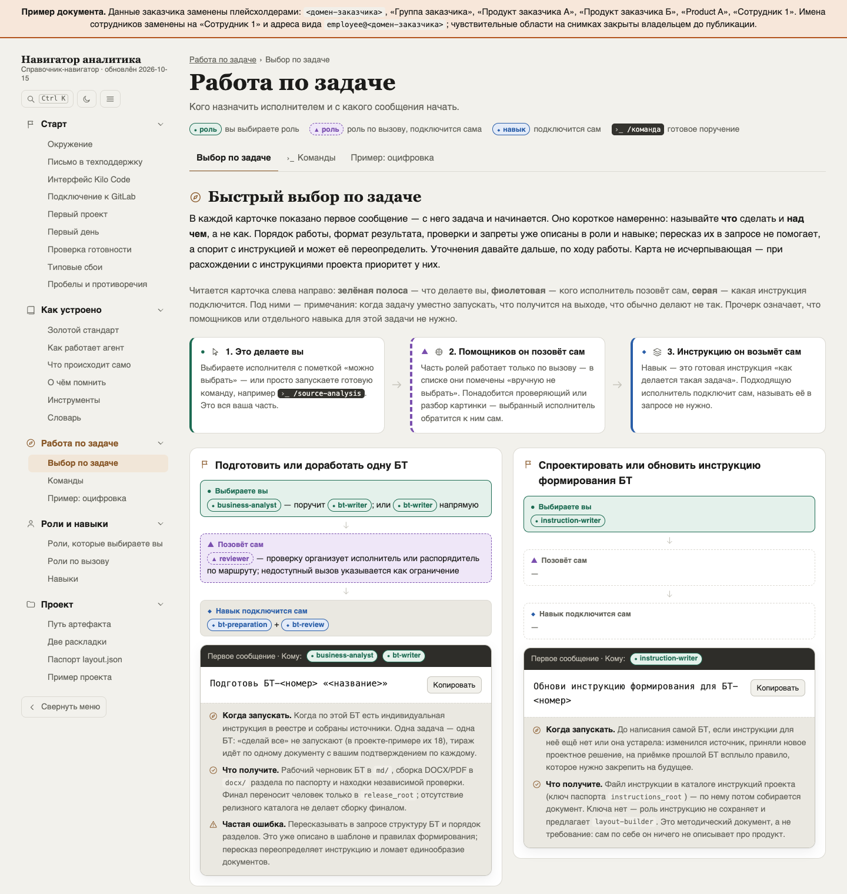
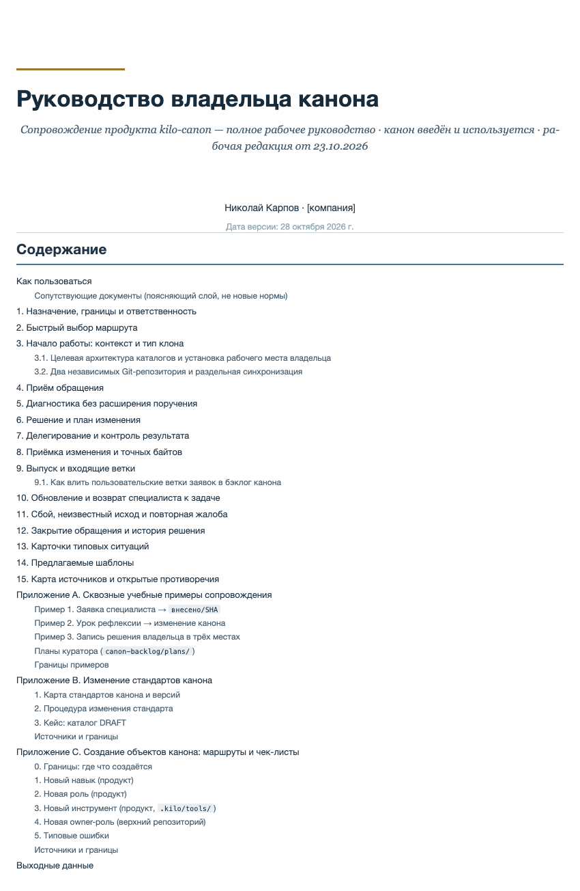
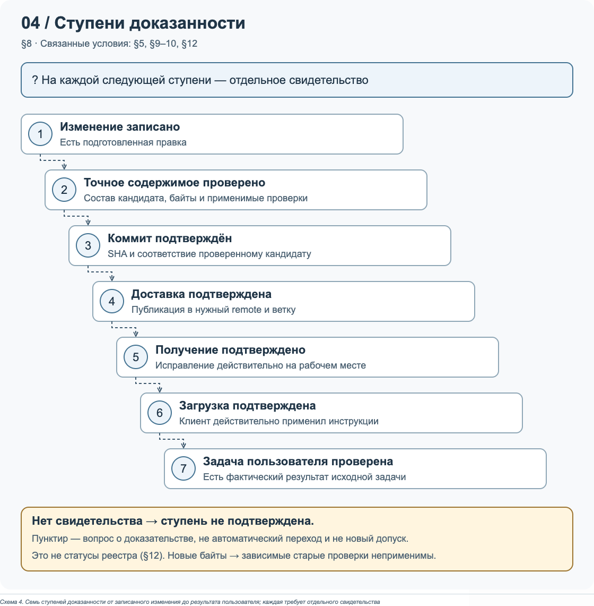
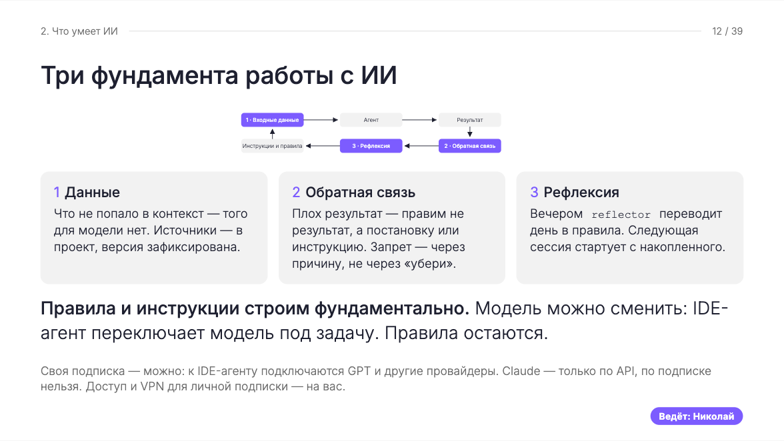

# Статья для Хабра — шпаргалка обновления v4

Дата: 30 октября 2026 года.

Это **карта изменений и картинок**, а не ещё одна полная редакция статьи. Указания из этого файла в публикацию не копировать.

- Текстовая основа: [habr-article-v3-copy.md](habr-article-v3-copy.md).
- Текущая статья с согласованным дизайном: [открыть на сайте](https://nikolai-karpov.github.io/my-website/site-pages/team-ai-enablement/habr-article.html).
- Отдельная `habr-article-designer.html` удалена: использовать только основную страницу.
- Доступа к хабрскому черновику нет. Ниже указано, что подготовлено в репозитории, а не что уже заменено на Хабре.

## 1. Самое важное — исправить факт внедрения

**Раздел «Как инструкции доходили до пользователей».**

Если в хабрском черновике осталось утверждение о двух людях за два месяца — удалить **весь этот абзац**, включая вывод о способе распространения канона. Оно отвергнуто автором.

Вместо него поставить подтверждённый автором факт:

> За месяц каноном начала пользоваться половина коллектива.

В основной HTML-статье это уже исправлено. В v3 этого предложения пока нет: не потерять его при переносе текста из Markdown.

## 2. Что изменилось по разделам

Обозначения:

- **ОБНОВИТЬ** — взять актуальную формулировку из v3/основной статьи, если в Хабре осталась прежняя.
- **СОХРАНИТЬ** — нового переписывания для v4 нет; не заменять текст ради изменения номера версии.
- **КАРТИНКА** — подготовлена иллюстрация; ниже указано место вставки.
- **ПРЕДЛОЖЕНИЕ** — идея обогащения, ещё не внесённая в текст статьи. Не выдавать её за согласованную новую редакцию.

| Раздел | Что делать |
| --- | --- |
| От личной практики к корпоративному внедрению | **СОХРАНИТЬ.** Вступление без новой правки для v4. Служебные метки версии не переносить |
| Боевая проверка: комплект бизнес-требований под дедлайн | **СОХРАНИТЬ** новый раздел из v3. Не потерять различие: 14 документов за восемь рабочих дней — цитата с вебинара; 17 БТ — итоговый комплект к передаче заказчику. Смена моделей под лимиты — решение под дедлайн, не общая рекомендация |
| С чем я пришёл к этой задаче | **СОХРАНИТЬ** текст v3 |
| Канон и структура проекта | **ОБНОВИТЬ** дерево: родительский каталог типа документов → каталог конкретного документа → `md/` и `docx/`. Релиз отдельно, после приёмки. В HTML убраны дубли заголовка и подписи перед схемой |
| Роль, навык и инструмент | **ОБНОВИТЬ** расположение абзаца про `project-layout`, `layout-builder`, `scaffold_layout.py` и паспорт: здесь, а не до объяснения ролей и навыков. Таблица элементов остаётся |
| Оцифровка: сохранить смысл источника | **СОХРАНИТЬ** текст v3. Нового скриншота оцифровки не подготовлено |
| Анализ источников и подготовка документов | **СОХРАНИТЬ** содержание v3. Перечень видов документов можно оформить списком; новых фактов это не добавляет |
| Сборка DOCX и проверка результата | **ОБНОВИТЬ**, если осталась старая версия случая передачи в разработку: передавали **Markdown**, загрязнённый ревизионными комментариями и метаданными сборки DOCX. Не писать, что передали DOCX. Процесс сборки оформить обычным списком, не показывать читателю обрамление ` ```markdown ` |
| Зачем канону понадобился владелец | **ОБНОВИТЬ** по сжатой версии v3: три абзаца и цепочка принятия улучшений. Не дублировать «Выпуск обновлений». **КАРТИНКИ 2 и 3:** руководство и проверка результата обновления. Расширение текста о самом руководстве пока **ПРЕДЛОЖЕНИЕ**, а не готовая вставка |
| Взаимное ревью агентов | **СОХРАНИТЬ** различие приложений и моделей, ограничения итераций, решение человека. Названия отдельных тестируемых моделей в v3 требуют уточнения — не превращать это в подтверждённый список удалением оговорки |
| Где канон ломался | **СОХРАНИТЬ** четыре случая из v3. Пример таблицы «Типовые сбои» из навигатора — **ПРЕДЛОЖЕНИЕ**; отдельной картинки этой таблицы пока нет |
| Как инструкции доходили до пользователей | **ОБНОВИТЬ** по сжатой версии v3: внедрение → персональные треки → навигатор → вебинар → отзывы → поддержка. Не возвращать удалённые повторные абзацы о малых группах. **Обязательно добавить исправленный факт о половине коллектива. КАРТИНКА 1** — после абзаца про навигатор. **КАРТИНКА 4** — после абзаца о вебинаре |
| Как я организовал поддержку через агентов | **ОБНОВИТЬ** по актуальному началу v3: срочная работа, Telegram-бот, агенты через коммутатор. Сохранить поручение владельца для диалога от его имени. **УДАЛИТЬ весь абзац «Типовое обращение в поддержку…»**, если он перенесён в хабрский черновик: автор подтвердил, что это разговор о поддержке других продуктов, а не канона. Вместе с примером удалены выведенные из него утверждения о первой линии и готовом анонимайзере. Не возвращать этот фрагмент и не дублировать полный список моделей |
| Анализ расхода токенов | **ОБНОВИТЬ** целиком по последнему v3: LiteLLM + Langfuse, длинные сессии и кэш, индексы `README.md`/`INDEX.md`, память по релевантности. В основной статье дополнительно сохранена граница результата: **«Это результат одного кейса, а не средняя по команде»**. Не делать из снижения вдвое командную метрику. График расходов не подготовлен |
| Как я разделил память пользователей и владельца канона | **ОБНОВИТЬ** по полной структуре v3: вводный абзац → рефлексия → память проектов → память владельца → будущий владелец рефлексии. Абзацы «РЕКОМЕНДУЮ ВЕРНУТЬ» уже сохранены в основной статье без служебных пометок. Обязательно оставить различие между извлечением записей и обучением модели; будущий слой не объявлять реализованным |
| Что в итоге стало рабочим местом аналитика | **ОБНОВИТЬ** по сжатой версии v3, включая оценку всей цепочки работы, рамку бизнес-заказчика и итог про накопление опыта. Не возвращать удалённые повторные описания «связки» |
| Заменит ли ИИ человека? | **ОБНОВИТЬ целиком** по зафиксированной авторской версии v3: калькулятор/экскаватор, функции агента, ответственность человека, обратная связь и накопление опыта. В основной статье этот порядок сохранён. **Главный акцент эпилога — оформить цитатой:** «Ценность написания чего-либо по готовым алгоритмам будет снижаться с эволюцией ИИ, а способность придумать что-то новое не обесценится никогда». Последний абзац «Профессиональная обвязка…» оставить обычным текстом |
| Материалы | **СОХРАНИТЬ** блок, но для ссылки на демонстрационный навигатор использовать актуальный публичный адрес из следующего раздела. Не давать ссылку на локальный рабочий оригинал |

## 3. Картинки: где взять и куда поставить

### Картинка 1. Навигатор специалиста — выбор по задаче

**Место:** раздел «Как инструкции доходили до пользователей», сразу после абзаца «Навигатор стал инструментом онбординга…», перед рассказом о вебинаре.

**Что показано:** интерфейс навигатора, выбор роли, подключаемые помощники и навыки, первые сообщения для подготовки БТ и инструкции.

- Локальный PNG: [habr-navigator-tasks.png](../../assets/images/habr-navigator-tasks.png).
- **Скачать PNG:** https://nikolai-karpov.github.io/my-website/assets/images/habr-navigator-tasks.png
- Публичная страница навигатора: https://nikolai-karpov.github.io/my-website/webinars/navigator.html#/work/tasks
- Размер: 1440 × 1520 px.
- **Готово.** Снимок переснят с обновлённой обезличенной публичной копии. Имена и корпоративные адреса в навигаторе заменены плейсхолдерами; изображения проверены отдельно, оставшийся внутренний контекст на снимке структуры проекта закрыт непрозрачной маской.



Подпись для вставки:

> Навигатор аналитика: от задачи к исполнителю, подключаемым навыкам и первому сообщению агенту.

Не вставлять вместо этого скриншот всего длинного навигатора. Один экран с конкретным маршрутом полезнее полного перечня вкладок.

### Картинка 2. Руководство владельца канона — обложка и содержание

**Место:** раздел «Зачем канону понадобился владелец», после объяснения его ответственности и сопровождения канона. Если добавляешь отдельный абзац о руководстве — сразу после него.

- **Скачать PNG:** https://nikolai-karpov.github.io/my-website/assets/images/habr-owner-guide.png
- Локальный файл: [habr-owner-guide.png](../../assets/images/habr-owner-guide.png).
- Размер: 850 × 1304 px.
- **Готово и опубликовано.** На изображении название компании заменено на `[компания]`. Рабочий оригинал не изменён.

Подпись:



> Руководство владельца канона: ответственность, диагностика, проверка изменений, выпуск и возврат специалиста к задаче. Название компании скрыто.

Это снимок обложки и содержания документа, а не доказательство выполнения всех описанных процедур.

### Картинка 3. Руководство — ступени проверки изменения

**Место:** тот же раздел, после цепочки «Улучшение проходит через владельца» либо после пояснения, почему опубликованное исправление ещё не означает решённую задачу специалиста.

- **Скачать PNG:** https://nikolai-karpov.github.io/my-website/assets/images/habr-owner-evidence.png
- Локальный файл: [habr-owner-evidence.png](../../assets/images/habr-owner-evidence.png).
- Размер: 1120 × 1141 px.
- **Готово и опубликовано.** Это изображение существующей схемы из руководства, не выдуманный интерфейс.

Подпись:



> От записанного изменения до результата пользователя: каждый следующий шаг требует отдельного подтверждения.

Если два изображения руководства перегружают раздел, **предпочесть эту схему**, а обложку с содержанием не вставлять. Схема объясняет процесс; обложка показывает объём и структуру документа.

### Картинка 4. Слайд вебинара — три фундамента

**Место:** раздел «Как инструкции доходили до пользователей», сразу после абзаца «Для обучения специалистов я подготовил и провёл…», перед отзывами специалистов.

- **Скачать PNG:** https://nikolai-karpov.github.io/my-website/assets/images/designer-webinar-foundations.png
- Локальный файл: [designer-webinar-foundations.png](../../assets/images/designer-webinar-foundations.png).
- **Готово и опубликовано ранее.** Если уже вставлен в хабрский черновик, повторно не добавлять.

Подпись:



> Из вебинара «ИИ в работе аналитика: подход и рабочий цикл»: данные, обратная связь и рефлексия.

## 4. Как вставить в Хабр

1. Открой ссылку **«Скачать PNG»** и сохрани изображение на компьютер.
2. В нужном месте текста добавь блок «Изображение» и загрузи сохранённый файл. Так публикация не будет зависеть от дальнейших изменений сайта.
3. В поле подписи вставь подпись из соответствующего пункта выше.
4. Проверь предпросмотр на телефоне: текст схемы должен читаться при открытии изображения, не быть обрезанным.
5. Не копируй в статью статусы готовности, пути файлов, размеры картинок и служебные указания этой шпаргалки.

## 5. Что пока не считать сделанным

- Новые развёрнутые абзацы о навигаторе как маршрутизаторе задач и о руководстве владельца **предложены, но не добавлены автоматически** в основной текст.
- Отдельного снимка таблицы «Типовые сбои» нет.
- Графиков расхода токенов и измеренного эффекта всей команды нет.
- Публичный навигатор обновлён и обезличен; его нельзя заменять сырым исходником рабочего репозитория. Повторная проверка перед публикацией: `npm run check:navigator` (полный аудит требует локального приватного блок-листа, который не публикуется).
- Хабрский черновик этими действиями не редактировался: перенос текста и загрузку изображений выполняет автор.
